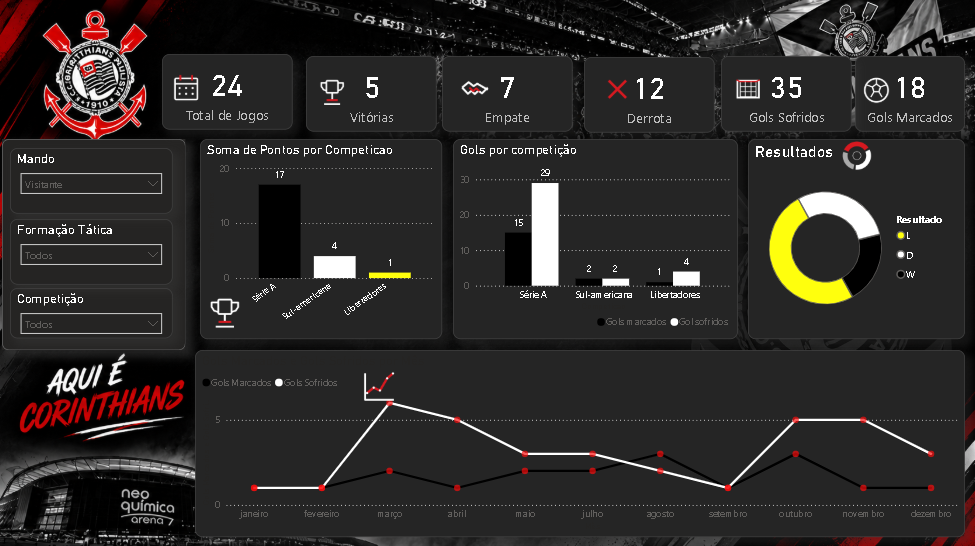
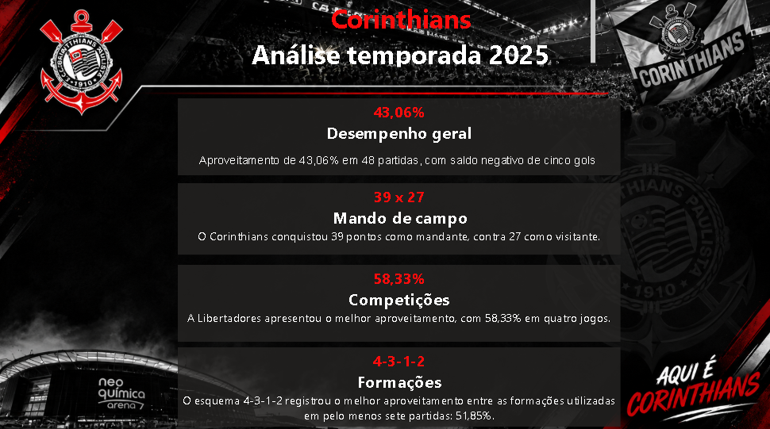

# ⚽ Corinthians Analytics 2025

**Análise de desempenho do Sport Club Corinthians Paulista utilizando Python, SQL Server e Power BI.**

## 📌 Sobre o projeto

O Corinthians Analytics 2025 é um projeto de análise de dados desenvolvido com o objetivo de avaliar o desempenho esportivo do Corinthians a partir de dados de partidas disputadas em 2025.

O projeto contempla o processo de análise de dados de ponta a ponta, incluindo auditoria, tratamento, validação, armazenamento em banco de dados, consultas SQL e desenvolvimento de um dashboard interativo.

A proposta é transformar dados esportivos em informações relevantes, permitindo identificar padrões de desempenho e comparar resultados por competição, mando de campo e formação tática.

## 🎯 Objetivos

- Analisar o desempenho geral da equipe.
- Comparar resultados entre competições.
- Avaliar o desempenho como mandante e visitante.
- Investigar o desempenho de diferentes formações táticas.
- Acompanhar a evolução mensal de gols marcados e sofridos.
- Desenvolver indicadores e insights por meio de visualizações interativas.


## 📊 Dashboard



### Principais insights



*Dashboard e insight desenvolvido no Power BI para análise do desempenho do Corinthians em 2025.*


## 🛠️ Tecnologias utilizadas

| Tecnologia | Aplicação |
|---|---|
| Python | Tratamento e análise de dados |
| Pandas | Manipulação e transformação de dados |
| Matplotlib | Visualização exploratória |
| SQL Server | Armazenamento e consultas |
| SQL | Agregações, indicadores e views |
| Power BI | Dashboard interativo |
| Git e GitHub | Versionamento e documentação |

## 🔄 Etapas do projeto

**1. Auditoria e exploração dos dados**
- Análise da estrutura da base.
- Verificação de valores ausentes.
- Identificação de possíveis inconsistências.
- Validação dos resultados das partidas.

**2. Tratamento com Python**
- Padronização de nomes de adversários.
- Normalização de formações táticas.
- Ajustes nos campos de data e horário.
- Tratamento de valores e exportação dos arquivos processados.

**3. Integração com SQL Server**
- Criação do banco de dados CorinthiansAnalytics.
- Criação da tabela de partidas.
- Importação dos dados tratados.
- Desenvolvimento de consultas SQL e views para análise.

**4. Desenvolvimento no Power BI**
- Integração com SQL Server.
- Criação de medidas DAX.
- Desenvolvimento de indicadores de desempenho.
- Construção de gráficos e filtros interativos.
- Elaboração de insights analíticos.

## 📊 Resultados da análise

A base analisada contém 48 partidas, distribuídas entre três competições.

| Indicador | Resultado |
|---|---:|
| Partidas analisadas | 48 |
| Vitórias | 16 |
| Empates | 14 |
| Derrotas | 18 |
| Gols marcados | 53 |
| Gols sofridos | 58 |
| Saldo de gols | -5 |
| Pontos conquistados | 62 |
| Aproveitamento | 43,06% |

### 🔎 Principais insights

- **Desempenho geral:** aproveitamento de 43,06% nas partidas analisadas.
- **Mando de campo:** 39 pontos conquistados como mandante, contra 27 como visitante.
- **Competições:** a Libertadores apresentou o maior aproveitamento, com 58,33% em quatro partidas.
- **Formações táticas:** o esquema 4-3-1-2 registrou 51,85% de aproveitamento em nove partidas.

## 📁 Estrutura do projeto

```text
Corinthians-analytics/
│
├── data/
│   ├── raw/
│   └── processed/
│
├── dashboards/
│
├── notebooks/
│
├── sql/
│
├── src/
│   ├── coleta_dados.py
│   ├── analise-corinthians.py
│   └── importar_sql.py
│
├── .gitignore
└── README.md
```

## ⚙️ Como executar

**1. Clone o repositório**

```bash
git clone URL_DO_REPOSITORIO
```

**2. Entre na pasta**

```bash
cd Corinthians-analytics
```

**3. Crie e ative o ambiente virtual no Windows**

```bash
python -m venv .venv
.venv\Scripts\activate
```

**4. Instale as dependências**

```bash
pip install pandas numpy matplotlib jupyter openpyxl requests sqlalchemy pyodbc
```

**5. Execute os scripts de análise e integração**, conforme a configuração do ambiente e do SQL Server.

**6. Abra o arquivo Power BI (.pbix)** para explorar o dashboard.

## ⚠️ Observação sobre os dados

Esta versão utiliza uma base parcial de 48 partidas, contemplando Série A, Copa Sul-Americana e Libertadores.

Portanto, os resultados apresentados representam exclusivamente as partidas incluídas na base analisada, não o desempenho completo do Corinthians em toda a temporada de 2025.

## 👨‍💻 Autor

Projeto desenvolvido como parte da construção de portfólio na área de Ciência de Dados, com foco em Business Intelligence, análise de dados e visualização de informações.

**Tecnologias:** Python | SQL Server | Power BI